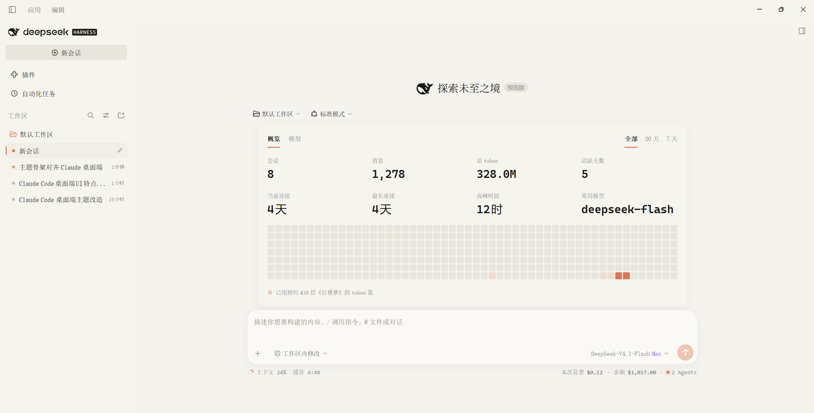
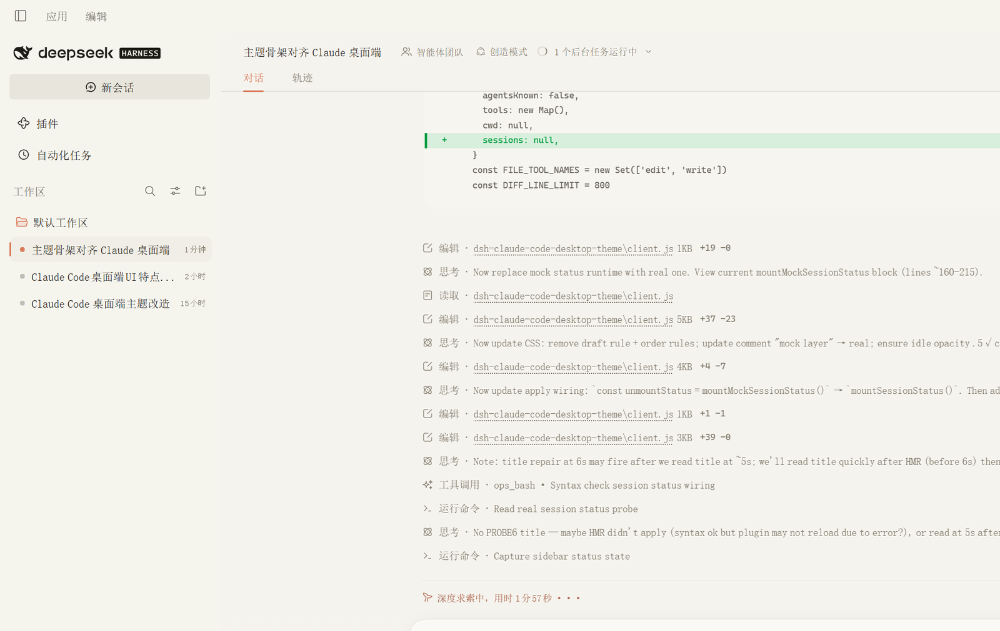

# dsh-claude-code-desktop-theme

把 **Claude Code 桌面端**的视觉语言搬到 DeepSeek Harness Web GUI 上：暖米色表面、陶土橙强调色、思源宋体界面、Absolutely 代码配色，附带真实的会话状态点、HUD、Diff 审查抽屉与用量概览卡片。

A Claude Code desktop-style theme for the **DeepSeek Harness** Web GUI, plus the merged usage-overview card, real session status dots, composer HUD and a diff review drawer.



## 功能

- **Claude Code 桌面端配色**：`#f5f3ee` 暖米色表面、`#1d1b16` 墨色文字、`#da7756` 陶土橙强调色；代码高亮使用 Absolutely 配色（diff 绿 `#00c853` / 红 `#ff5f38`）。
- **思源宋体界面**：UI 使用 Source Han Serif / Noto Serif SC 字体栈，并内置一个 3.9 KB 的标题宋体子集（SIL OFL 1.1），保证首页标题在任何机器上都是宋体。
- **首页仪表盘**：用量概览卡片固定在左上角，以全屏布局为基准等比缩放（窗口变小时整体缩放、比例不变；侧边栏隐藏时自动居中）。
- **真实状态点**：侧栏会话状态来自宿主真实数据——运行中显示 14px 橙色旋转圆弧，等待确认显示橙点，空闲显示灰色圆点；圆点是 CSS 伪元素，React 重渲染不会让它消失。
- **Composer HUD**：输入框下方显示真实的上下文占用、缓存命中率、本次花费与实时 tok/s（空闲自动显示 0 tok/s）；余额显示在侧栏底部账户行。
- **Diff 微标 + 审查抽屉**：编辑/写入工具卡片右上角显示真实 `+N −M`，点击打开右侧审查抽屉查看真实 diff；无数据时显示空状态，不伪造内容。
- **工作区 / 模式菜单向上展开**：首页的两个下拉菜单从触发器上方弹出，不会遮挡输入框。
- **用量概览（已合并）**：会话/消息/token 统计、连续天数、高峰时段、常用模型（通过宿主模型目录解析真实展示名）与 26 周热力图；Host 汇总路由随主题插件一起提供。



## 安装

### 方式一：DSH 插件管理（推荐）

1. 打开 DeepSeek Harness → **设置 → 插件**；
2. 搜索并安装 `dsh-claude-code-desktop-theme`；
3. 启用后立即生效（主题插件会写入 Claude Code 桌面端配色）。

### 方式二：手动加入 profile

在你的 DSH profile 目录（桌面端通常是 `~/.dsh/profiles/desktop`）执行：

```bash
pnpm add dsh-claude-code-desktop-theme
```

然后在 `package.json` 的 `dsh.profile.bundles` 中加入：

```json
"dsh-claude-code-desktop-theme"
```

重启 DSH（或重新加载插件）即可。

### 方式三：从本仓库安装

```bash
git clone https://github.com/165890/dsh-claude-code-desktop-theme.git
cd dsh-claude-code-desktop-theme
# 在 profile 中 link 本地目录
cd ~/.dsh/profiles/desktop
pnpm add link:/path/to/dsh-claude-code-desktop-theme
```

并把 `dsh-claude-code-desktop-theme` 加入 `dsh.profile.bundles`。

## 兼容性

- 开发与验证版本：**DeepSeek Harness `0.2.1-rc.2`**（Desktop profile，Electron 渲染进程，Web GUI）。
- 插件通过宿主公开的 `ctx.theme` / `ctx.slots` / `ctx.remote` 服务工作，不修改宿主源码。
- 视觉层依赖 Harness Web GUI 的 CSS Module 选择器（如 `._2H3hWW_root`、`.Dc7zOa_composerHero`）。这些选择器由 Harness 构建产物生成，**升级 Harness 后可能变化**；不匹配时主题 Token 与组件（HUD/用量卡片/Diff 抽屉）仍会正常工作，只是个别外壳几何样式可能不生效。
- 需要 DSH Web GUI 的 Desktop 或 Web profile；插件同时注册 Host 路由（`POST /api/dsh-claude-code-desktop-theme/usage-summary`）与 Client 卡片。

## 使用说明

- 主题自动跟随 Claude Code 桌面端的浅色外观；系统偏好为 `system` 时插件会切到浅色。
- 首页左上角的用量卡片按全屏比例缩放，窗口大小变化时保持长宽比；侧边栏收起时居中显示。
- 侧栏状态点、HUD、余额、用量卡片全部读取宿主真实数据，不包含 mock/占位值。
- 卸载/禁用插件会自动撤销 Token 覆盖层、注入的 DOM 与监听器。

## 开发

仓库结构：

```
.
├── index.js            # Host half：用量汇总路由（POST /api/...）
├── client.js           # Client half：主题 Token、外壳样式、HUD、状态点、用量卡片、Diff 抽屉
├── cordis.patch.yml    # DSH bundle 入口
├── locale/             # 插件市场展示用名称/描述
├── assets/             # 内置宋体子集与 OFL 许可证
├── preview*.png        # 截图
├── docs/DESIGN.zh.md   # 设计记录（内部实现笔记）
└── .github/workflows   # CI：语法检查 + 打包检查
```

本地检查：

```bash
npm run check      # node --check index.js client.js
npm pack --dry-run # 查看发布内容
```

## 许可证

[MIT](LICENSE)。内置字体子集来自 Noto Serif SC（SIL Open Font License 1.1），许可证见 `assets/OFL.txt`。

## 致谢

- DeepSeek Harness 提供的插件与主题扩展点；
- Claude Code 桌面端的视觉参考；
- Noto Serif SC / Source Han Serif 字体项目。
