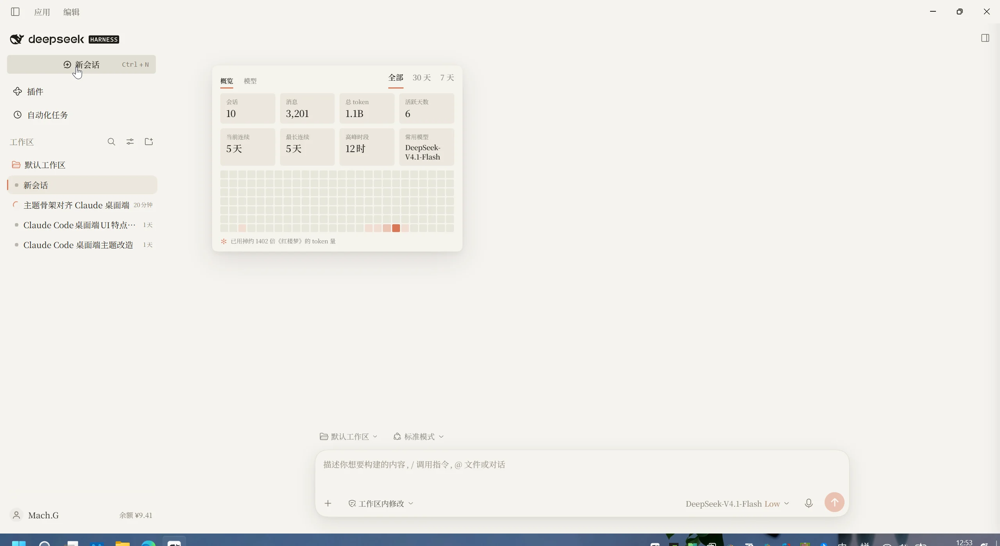
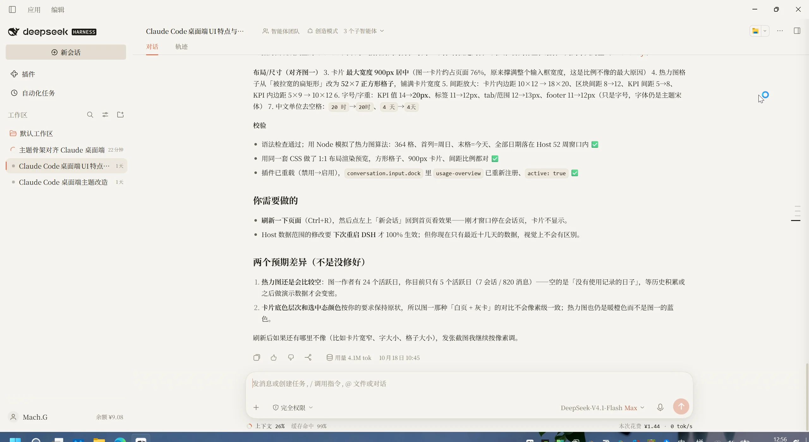
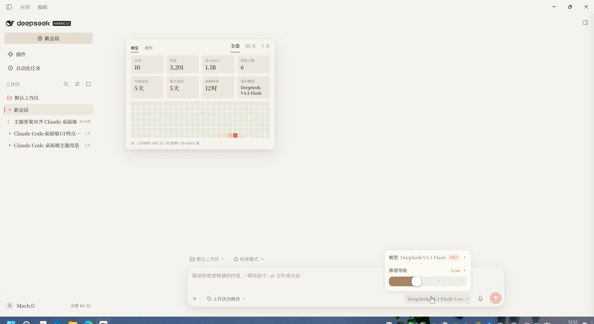
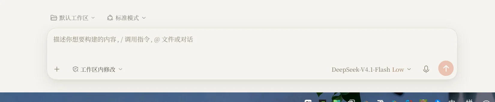
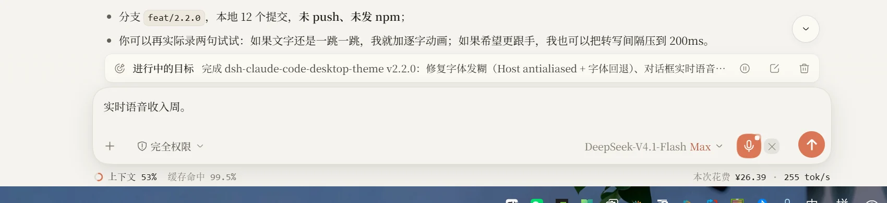

# dsh-claude-code-desktop-theme

把 **Claude Code 桌面端**的视觉语言搬到 DeepSeek Harness Web GUI 上：暖米色表面、陶土橙强调色、思源宋体界面、Absolutely 代码配色，附带真实的会话状态点、HUD、Diff 审查抽屉与用量概览卡片。

A Claude Code desktop-style theme for the **DeepSeek Harness** Web GUI, plus the merged usage-overview card, real session status dots, composer HUD and a diff review drawer.

[](https://github.com/165890/dsh-claude-code-desktop-theme/actions/workflows/ci.yml)
[](https://www.npmjs.com/package/dsh-claude-code-desktop-theme) [](LICENSE)



## 功能

- **Claude Code 桌面端配色**：`#f5f3ee` 暖米色表面、`#1d1b16` 墨色文字、`#da7756` 陶土橙强调色；代码高亮使用 Absolutely 配色（diff 绿 `#00c853` / 红 `#ff5f38`）。
- **内嵌宋体界面（不再依赖本机字体）**：2.6 MB 的 Noto Serif SC GB2312 + ASCII 子集（woff2，SIL OFL 1.1）不再内联进 `client.js`，改由 Host 路由 `GET|HEAD /api/dsh-claude-code-desktop-theme/font` 提供（单文件 allowlist、immutable、ETag）；client 用 `FontFace` 异步加载，首屏先渲染系统宋体栈、加载完成自动切换，路由失败/超时（8s）时 `console.warn` 并回退系统宋体栈，不白屏。常见中文仍由插件自带字体渲染，不依赖本机是否安装思源宋体。
- **首页仪表盘**：用量概览卡片固定在左上角，以全屏布局为基准等比缩放（窗口变小时整体缩放、比例不变；侧边栏隐藏时自动居中）。
- **真实状态点**：侧栏会话状态来自宿主真实数据——运行中显示 14px 橙色旋转圆弧，等待确认显示橙点，空闲显示灰色圆点；圆点是 CSS 伪元素，React 重渲染不会让它消失。
- **Composer HUD**：输入框下方显示真实的上下文占用、缓存命中率、本次花费与实时 tok/s（空闲自动显示 0 tok/s）；余额显示在侧栏底部账户行。
- **Diff 微标 + 审查抽屉**：编辑/写入工具卡片右上角显示真实 `+N −M`，点击打开右侧审查抽屉查看真实 diff；无数据时显示空状态，不伪造内容。
- **工作区 / 模式菜单向上展开**：首页的两个下拉菜单从触发器上方弹出，不会遮挡输入框。
- **对话框语音输入（实时转写）**：主题自带一颗麦克风（位于发送键左侧）——录音时约每 0.3s 把累计音频送到官方 `speech` Remote 转写，文字**边说边出现在输入框里**（小块结果用逐字显示动画铺开，避免整句猛跳）；约 6s 没检测到人声自动停止，停止后做一次整段转写替换最终结果，点 × 放弃。回写草稿时已去掉 Lexical 多余的换行，避免每次录音把聊天框撑大。官方实验语音 Bundle 未启用/未授权/识别失败时自动回退官方麦克风。
- **推理等级滑条（已合并）**：官方模型菜单里的「推理等级」行变成一条可拖动的连续滑条，最高档亮起奶油/陶土橙能量层、暖色星尘与扫光；原 `dsh-codex-effort-slider` 的算法、设置面板与 fail-open 行为完整保留，只换配色。已安装独立滑条插件时会自动跳过，避免双滑条。
- **用量概览（已合并）**：会话/消息/token 统计、连续天数、高峰时段、常用模型（通过宿主模型目录解析真实展示名）与 26 周热力图；Host 汇总路由随主题插件一起提供。
- **像素小鲸鱼桌宠**：输入框卡片右上角的 16×16 像素 DeepSeek 小鲸鱼（2× 显示），会呼吸、随机眨眼、悬停有反应、点击开心、发送消息时冲刺；位置避开正文/发送/语音键，窗口隐藏或不可见时暂停，`prefers-reduced-motion` 全降级。点右上角「×」隐藏，隐藏后可从 HUD 托盘右侧的「鲸」按钮恢复；状态存在 `localStorage['dsh-theme-pet-hidden']`。设计规格见 [docs/PET.zh.md](docs/PET.zh.md)，诊断用 `__dshClaudeThemePetDebug()`。










## 安装

### 方式一：DSH 插件管理（推荐）

1. 打开 DeepSeek Harness → **设置 → 插件**；
2. 搜索并安装 `dsh-claude-code-desktop-theme`；
3. 启用后立即生效（主题插件会写入 Claude Code 桌面端配色）。

> **语音输入**需要额外启用一个官方 Bundle（默认关闭），步骤见下面的「语音输入默认是没有的」。
>
> 如果之前装过独立的 `dsh-codex-effort-slider`，请先禁用/卸载它再使用本主题，避免两个滑条同时出现。

#### 语音输入默认是没有的，需要单独启用

主题自带的实时语音麦克风**依赖官方「语音输入」实验 Bundle**：该 Bundle 随 DSH 安装但**默认关闭**，关闭状态下系统里没有任何麦克风——主题不会凭空造一个，只会安静地不显示。

启用步骤：

1. 打开 **设置 → 插件**，找到带**蓝色声波图标**的「语音输入」（`@deepseek-ai/dsh-experimental-voice-input-bundle`），把它**启用**；
2. 首次使用要先准备识别模型：打开该 Bundle 详情 → **下载并准备**（在本机下载 SenseVoice 模型，约 0.2–0.3 GB，需预留磁盘与内存，不需要 Python 或编译工具）；
3. 模型就绪后，麦克风会出现在**模型选择器与发送按钮之间**；本主题会把官方那颗换成奶油/陶土橙的实时语音麦克风（录音时约每 0.3 s 增量转写，点麦克风停止并插入）。

> **看不到麦克风时按顺序排查**：① 语音输入 Bundle 是否已启用；② 模型是否已下载完成；③ 若插件列表里根本没有这个 Bundle，说明 DSH 版本过旧，需要先升级 DSH。

> **刚发版后为什么会装到旧版**
>
> pnpm 11 默认启用 `minimumReleaseAge`：**发布未满 24 小时的版本不会被自动安装**，解析器会静默回退到「已过观察期的最新版本」。
> 所以新版发布后的 24 小时内，在插件管理里直接搜索安装，装到的可能仍是更旧的版本——这不是发布失败，`latest` 也是对的。
> （2026-10-20 的实例：2.5.0 已发布且 `latest` 指向它，但全新安装解析到了 2.1.5，因为 2.2.0 / 2.2.1 / 2.5.0 都还没过观察期，而 2.1.5 过了。）
>
> 需要**立刻**用新版，就装精确版本（精确版本会跳过观察期）：
>
> ```
> dsh-claude-code-desktop-theme@2.5.0
> ```
>
> 在插件管理的安装框里直接填这一行即可；或者等发布满 24 小时后再普通安装。
> 维护者可用 `npm run check:install` 查看此刻全新安装会解析到哪个版本。

### 方式二：手动加入 profile

在你的 DSH profile 目录（桌面端通常是 `~/.dsh/profiles/desktop`）执行：

```bash
pnpm add dsh-claude-code-desktop-theme
# 发布未满 24 小时时装到旧版，就指定精确版本：
pnpm add dsh-claude-code-desktop-theme@2.5.0
```

然后在 `package.json` 的 `dsh.profile.bundles` 中加入：

```json
"dsh-claude-code-desktop-theme"
```

重启 DSH（或重新加载插件）即可。

### 方式三：从本仓库安装

```bash
git clone https://github.com/165890/dsh-claude-code-desktop-theme.git
cd dsh-claude-code-desktop-theme
# 在 profile 中 link 本地目录
cd ~/.dsh/profiles/desktop
pnpm add link:/path/to/dsh-claude-code-desktop-theme
```

并把 `dsh-claude-code-desktop-theme` 加入 `dsh.profile.bundles`。

## 兼容性

- 开发与验证版本：**DeepSeek Harness `0.2.1-rc.2`**（Desktop profile，Electron 渲染进程，Web GUI）。
- 插件通过宿主公开的 `ctx.theme` / `ctx.slots` / `ctx.remote` 服务工作，不修改宿主源码。
- 视觉层依赖 Harness Web GUI 的 CSS Module 选择器（如 `._2H3hWW_root`、`.Dc7zOa_composerHero`）。这些选择器由 Harness 构建产物生成，**升级 Harness 后可能变化**；不匹配时主题 Token 与组件（HUD/用量卡片/Diff 抽屉）仍会正常工作，只是个别外壳几何样式可能不生效。
- 需要 DSH Web GUI 的 Desktop 或 Web profile；插件同时注册 Host 路由（`POST /api/dsh-claude-code-desktop-theme/usage-summary`）与 Client 卡片。
- **外接模型的推理强度滑条**：滑条只增强官方的「推理等级」行，而官方行取决于模型有没有在 `llm-pi-ai` 配置里声明 `reasoningEfforts`。外接模型默认没声明，所以既没有强度行、也发不出强度参数。开启方法、`thinkingFormat` 对照表，以及推理模型最容易踩的 `developer` 角色 400，见 [docs/EFFORT.zh.md](docs/EFFORT.zh.md)。

## 使用说明

- 主题自动跟随 Claude Code 桌面端的浅色外观；系统偏好为 `system` 时插件会切到浅色。
- 首页左上角的用量卡片按全屏比例缩放，窗口大小变化时保持长宽比；侧边栏收起时居中显示。
- 侧栏状态点、HUD、余额、用量卡片全部读取宿主真实数据，不包含 mock/占位值。
- **数据来源**：上下文占用、缓存命中率与实时 `tok/s` 直接来自宿主 `contextPressure` / `tokenUsage` / `sessionStats` 投影，会话开始后立即显示，不依赖任何第三方信息栏插件。
- **实时性**：`tok/s` 改为 2 秒滚动窗口（500ms 采样、流停约 1.2s 归零），流式期间用 assistant 分块估算、步末用 provider 真值校准；上下文保留 1 位小数并在流式期叠加当前 step 估算，结算时 150ms 过渡；数字槽固定宽度，更新只动 `opacity/transform`，不触发布局抖动。空闲 2s、运行 500ms 自适应刷新，窗口隐藏时暂停。
- **本次花费**：若已安装 [dsh-bottom-info-bar](https://github.com/songoao25/dsh-bottom-info-bar) 并启用其账本，优先显示实扣金额；否则按 token 用量估算，**估算值带 `~` 前缀**（`~¥0.12`），悬停可见价格来源。外接 provider（pi-ai 路由）也会估算：内置「精确目录 → 模型族 → provider 前缀 → 兜底」四层匹配，未知模型不再显示 `—` 而是标注未知估算；币种随模型取 `¥`/`$`。可用 `~/.dsh/dsh-claude-code-desktop-theme/pricing.json` 覆盖价格，格式见 [docs/COST.zh.md](docs/COST.zh.md)。
- **余额**：先立即显示上次成功读取的余额缓存，再在账户服务返回后刷新为实时值；未登录 DeepSeek 账户时显示 `—`。
- **深色模式**：浅色/深色都有完整配色；设置里切换外观后，侧栏、composer、HUD、Diff 抽屉与滑条能量层会一起变化。
- **字体诊断**：在 DevTools 执行 `__dshClaudeThemeFontDebug()`，会打印平台、DPI、实际 `-webkit-font-smoothing`、实际字体栈，以及内嵌宋体是否加载成功（反馈字体问题请附上这段输出）。
- **实时语音**：AudioWorklet 采集并显式重采样到 **16kHz 单声道 PCM16**（宿主只接受这种 WAV，这也是此前「识别不准」的主因；AudioWorklet 不可用时回退 ScriptProcessor）。每 ~1.2s 只上传**新增音频**（带 0.4s 重叠做文本去重），停止时再对整段音频做一次最终转写并覆盖预览；约 6s 无人声自动停止，60s 上限。录音动画只做 `transform/opacity`，不会撑高输入框；切换会话、隐藏窗口、卸载、失败都会释放麦克风并把官方麦克风放回来。
- **语音输入**：录音/转写由 DSH 官方语音子系统完成；权限被拒绝时显示官方错误提示。诊断：`__dshClaudeThemeHudDebug()` / `__dshClaudeThemeFontDebug()` / `__dshClaudeThemeStatusDebug()`。
- **推理等级滑条**：拖动时即时写回官方档位，松手立即落地；找不到官方菜单锚点或会话作用域未就绪时 fail-open，不影响官方菜单。
- 卸载/禁用插件会自动撤销 Token 覆盖层、注入的 DOM、字体样式、滑条样式与所有监听器。

## 自动更新

从 npm 安装的用户（profile 里是版本号，而不是 `link:`）会在**设置 → 插件 → 本插件卡片**的「当前版本」下方看到一条更新状态：

1. **自动检查**：打开插件页时查询 npm 上的最新版本，显示「当前 x.y.z · 最新 a.b.c」；
2. **观察期说明**：pnpm 11 默认不解析发布未满 24 小时的版本，直接装 `latest` 会静默落到旧版。此时面板会写明「发布未满 24 小时」，并给出普通安装可用的时间；
3. **一键更新（精确版本）**：点「更新到 a.b.c」并确认后，插件会按**精确版本**安装（跳过观察期），装完**回读磁盘上的版本做校验**，再提示重启 DeepSeek Harness 生效；
4. **失败不甩锅**：安装失败、校验不一致、或 profile 是 `link:` 本地开发模式时，面板会说明原因；可复制的安装命令就在旁边；
5. **不静默、不自动重启**：只检查 + 提示，安装必须由你点确认，重启也由你决定。

> 本地开发（`link:`）模式不会走 npm 更新：面板仍会对比「本地版本 vs npm 最新版」，落后时提示到工作副本执行 `git pull`，并可直接复制 `git -C <目录> pull` 命令。

## 开发

仓库结构：

```
.
├── index.js            # Host half：用量汇总路由（POST /api/...）
├── client.js           # Client half：主题 Token、外壳样式、HUD、状态点、用量卡片、Diff 抽屉
├── cordis.patch.yml    # DSH bundle 入口
├── locale/             # 插件市场展示用名称/描述
├── assets/             # 内嵌宋体子集（GB2312 woff2 + 标题子集）与 OFL 许可证
├── preview*.webp       # 截图（WebP，随包发布）
├── docs/DESIGN.zh.md   # 设计记录（内部实现笔记）
└── .github/workflows   # CI：语法检查 + 打包检查
```

本地检查：

```bash
npm run check        # node --check index.js client.js
npm pack --dry-run   # 查看发布内容
npm run check:install # 全新环境此刻会装到哪个版本（受 pnpm 24h 观察期影响）
```

### 发版

```bash
npm version patch   # 或 minor / major，会创建提交与 tag
git push --follow-tags
```

推送 `v*` tag 后，GitHub Actions 的 **Release** 工作流会：

1. 校验 tag 与 `package.json` 版本一致；
2. 运行 `npm run check` 与 `npm pack --dry-run`；
3. 优先尝试 **npm OIDC Trusted Publishing**；若该包尚未识别到 OIDC 信任配置，
   自动回退到仓库 secret `NPM_TOKEN` 执行 `npm publish --access public --provenance`。

> npm 新包/部分发布可能先进入 **staged publishing** 队列，需要维护者在 npm 网站（Staged Packages）用 2FA 批准后才会正式上线。

## 许可证

[MIT](LICENSE)。

- 内嵌字体子集来自 **Noto Serif SC**（SIL Open Font License 1.1），许可证见 `assets/OFL.txt`。
- 推理等级滑条改编自 [**dsh-codex-effort-slider**](https://github.com/Microqian2th/dsh-codex-effort-slider) v1.1.1（MIT，© 2026 dsh-codex-effort-slider contributors），算法与交互保留，配色重映射到本主题的奶油/陶土橙色阶。原项目许可证文本见 [THIRD_PARTY.md](docs/THIRD_PARTY.md)。

## 致谢

- DeepSeek Harness 提供的插件与主题扩展点；
- Claude Code 桌面端的视觉参考；
- Noto Serif SC / Source Han Serif 字体项目；
- dsh-codex-effort-slider 的滑条实现与测试。
